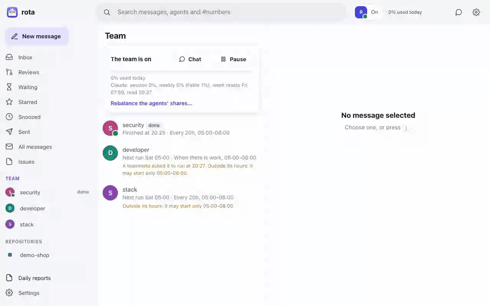

<p align="center"></p>

<h1 align="center">rota</h1>

<p align="center"><b>A team of AI agents that looks after your software in shifts, also while you sleep.</b></p>

Scouts look for problems in your repositories and open GitHub issues. A developer turns issues into
draft pull requests, with tests, evidence and notes on what to check. You read it all in an inbox that
works like mail: answer their questions, review their pull requests, and merge what you like. Nothing
is merged or deployed without you, unless you decide otherwise.

Everything runs on your own machine: one command, a team folder of Markdown files, Claude Code, git and
the GitHub CLI.

> [!IMPORTANT]
> **rota works only with Claude Code.** Every agent is a Claude Code session, and the team's budget is
> a share of your Claude subscription (Pro or Max). It does not work with Codex, Gemini, Cursor, Copilot
> or any other AI tool.

## Install with one prompt

You need macOS or Linux, Claude Code logged in with a Claude subscription, and a GitHub account.

1. Get the code and open Claude Code in it:

   ```sh
   git clone https://github.com/marashiai/rota.git
   cd rota
   claude
   ```

2. Paste this prompt:

   ```
   Install rota for me: read setup/SETUP.md and follow it.
   ```

Claude Code checks what's missing and installs rota. Then it asks which repositories the team should
look after, studies each one (what it is, how it's tested, how and where it's deployed), asks you what
it couldn't find out, and builds a team that fits from [proven blueprints](setup/blueprints/). It changes
nothing in your repositories while it does this. Expect 10 to 20 minutes.

## A tour

These recordings show a real run on a small demo web shop. The setup prompt built a security scout, a
stack scout and a developer for it, and a rollout agent was added from its blueprint afterwards.
Everything in them, from the issues and pull requests to the notes and replies, was made by the agents
in under an hour.

### Your team

Each agent is a Markdown file: its role (the prompt that says what it does), its schedule, model,
tools and repositories. Edit any of it on its page. Run now puts an agent first in line: when nothing
else is running, its shift starts at once.

<p align="center"></p>

### Watch a shift live

Every step an agent takes shows up as it happens, and stays there afterwards.

<p align="center"></p>

### What the scouts find

Each issue comes with its evidence: how to reproduce or exploit it, the code, and the fix the scout
would make. `j` and `k` step through them.

<p align="center"></p>

### Your inbox

What needs you comes first: questions, to-dos and pull requests waiting for your review. Updates hold
what each shift did and a report of your day. Reply to any message and it reaches the agent like an
email.

<p align="center"></p>

### Review a pull request

The developer opens draft pull requests that say what was wrong, what changed and how it was
verified, and leaves notes on exactly what you must check. Answer a note, send your review, and the
developer answers in the thread. Approve when you're happy.

<p align="center"></p>

### Talk to the team

Ask the Team what anyone is doing, or tell it what to change: it proposes the change and you apply
it. Write `@` and an agent's name to reach it; while it works, it answers right there.

<p align="center"></p>

### On your phone

The same inbox works on your phone over Tailscale. Add it to your Home Screen for notifications.

<p align="center"></p>

## How it works

- **Shifts.** The organizer (`rota start`) runs one agent at a time as a `claude -p` session, when it is
  due and inside its hours. Close it and everything stops.
- **The team pool.** The agents together use a share of your Claude subscription that you set (20% of
  each day's part of your weekly window by default), split by weights you choose. That is the only limit.
- **GitHub is the workplace.** Scouts open issues, the developer opens draft pull requests from its own
  branches, and agents talk to each other in notes on them. You stay the one who merges.
- **The team folder.** `~/.rota` holds each agent as a Markdown file (settings on top, its role below),
  the shared brief, the journal of every shift, notes, questions and reports. Edit any of it, or ask the
  Team in the chat to change it for you.
- **Everywhere you are.** The inbox in your browser, the menu bar on macOS, your phone over Tailscale,
  and a terminal console.

## Learn more

- [docs/reference.md](docs/reference.md): every feature and setting in detail.
- [setup/blueprints](setup/blueprints/): the agent roles the setup builds your team from.
- [gloss/README.md](gloss/README.md): the pull-request reviewer built into the inbox.
