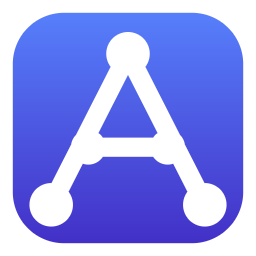
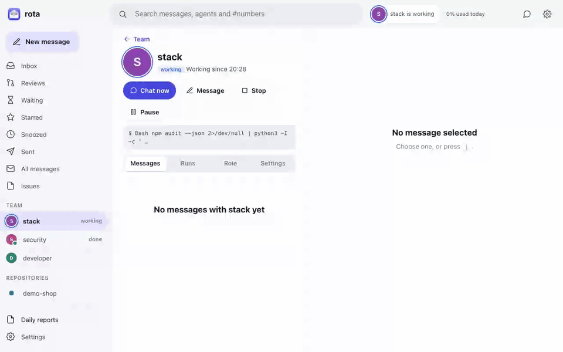
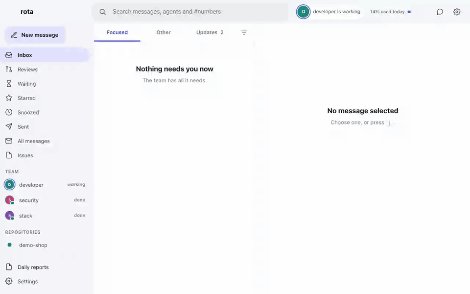
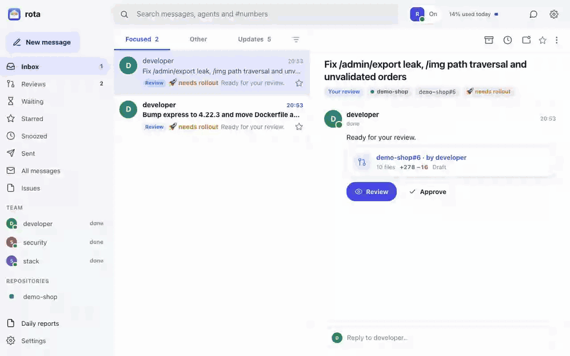
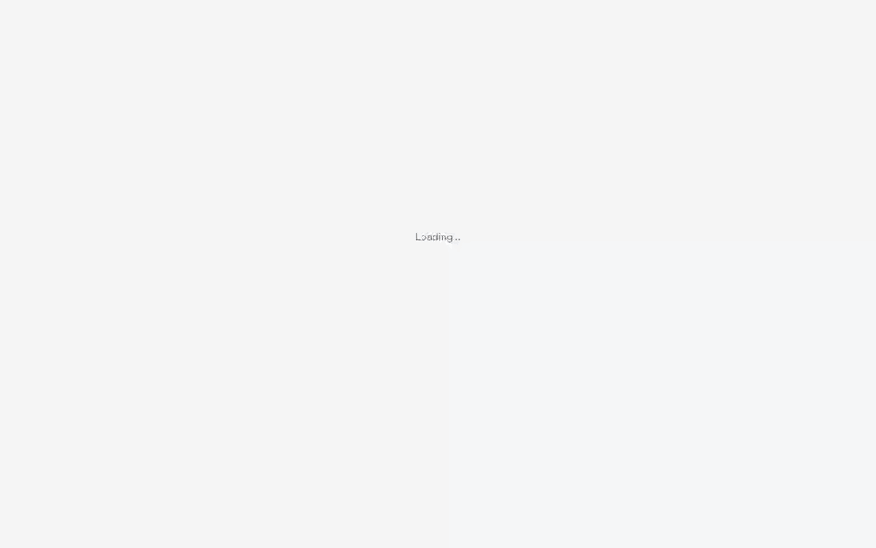

<p align="center"></p>

<h1 align="center">rota</h1>

<p align="center"><b>R</b>otating <b>O</b>n-call <b>T</b>eam of <b>A</b>gents</p>

<p align="center"><b>A team of AI agents that looks after your software in shifts, also while you sleep.</b></p>

Scouts look for problems in your repositories and open GitHub issues. A developer turns issues into
draft pull requests, with tests, evidence and notes on what to check. You read it all in an inbox that
works like mail: answer their questions, review their pull requests, and merge what you like. Nothing
is merged or deployed without you, unless you decide otherwise.

Everything runs on your own machine: one command, a team folder of Markdown files, Claude Code, git and
the GitHub CLI.

> [!IMPORTANT]
> **rota works only with Claude Code.** Every agent is a session of the Claude Code CLI (`claude -p`),
> and the team's budget is a share of your Claude subscription (such as Pro or Max). It does not work
> with Codex, Gemini, Cursor, Copilot or any other AI tool.

## It uses only the Claude budget you give it

You decide how much of your Claude plan the agents may use: a share of each day's part of your weekly
limit, 20% by default, for all the agents together. rota reads your real usage from Claude, starts no new
shift once the share is used up and stops the one that is running, so the rest of your plan stays
yours. Change the share any time in Settings, and split it between the agents by weight: rota proposes
new shares from what each agent really used.

<p align="center"></p>

## Install

You need:

- a Mac with Apple Silicon (M1 or later) and macOS 13 or newer. On an Intel Mac or Linux, rota is built
  from source instead: see [below](#on-an-intel-mac-or-linux);
- **the Claude Code CLI**, the `claude` command in a terminal, logged in with a Claude subscription such
  as Pro or Max. rota runs `claude -p` for every shift, so the CLI is required even if you use the Claude
  desktop app. Install it with `curl -fsSL https://claude.ai/install.sh | bash` (or
  `brew install --cask claude-code`), then log in with `claude auth login`;
- a GitHub account. The setup installs anything else that's missing (git and the GitHub CLI) after
  asking you.

1. **Download the app.** [Download rota for Apple Silicon Macs](https://github.com/marashiai/rota/releases/latest/download/rota-macos-arm64.dmg),
   open it, drag rota to Applications and open it from there. The app isn't signed with an Apple
   Developer ID, so macOS refuses to open it the first time: open System Settings › Privacy & Security,
   click Open Anyway next to the message about rota, and confirm. rota appears in the menu bar and puts
   the `rota` and `gloss` commands in `~/.local/bin`.

2. **Set up your team with one prompt.** Open a terminal, start Claude Code with `claude`, and paste:

   ```
   Set up rota for me: run ~/.local/bin/rota setup and follow the guide it gives you.
   ```

`rota setup` gives Claude Code the setup guide that comes with the rota you installed. Claude Code checks
what else is missing. Then it asks which repositories the team should look after and studies each one:
what it is, how it runs and is tested, and how and where it's deployed. Every question comes with its
recommended answer first, worked out from your code, so most of the time you just accept it. It asks about your schedule and how much of your Claude limit the agents may use,
then shows a summary of all your answers. You can change any of them before you confirm, and nothing is
created until you do. Then it builds a team that fits from [proven blueprints](setup/blueprints/). It
changes nothing in your repositories while it does this. Expect 10 to 20 minutes.

Run the setup in Claude Code in a terminal. The Claude desktop app and claude.ai/code are not supported
for it: claude.ai/code runs in the cloud and can't install anything on your computer, and the desktop
app doesn't provide the `claude` command that rota needs. Every version of the app is on the
[releases page](https://github.com/marashiai/rota/releases).

### On an Intel Mac or Linux

There's no ready-made app, so the setup builds rota from source, with Go, which it offers to install.

1. Get the code and open Claude Code in it:

   ```sh
   git clone https://github.com/marashiai/rota.git
   cd rota
   claude
   ```

2. Paste this prompt:

   ```
   Install rota for me: read setup/SETUP.md and follow it.
   ```

It builds rota, then sets up your team the same way.

## A tour

These recordings show a real run on a small demo web shop. The setup prompt built a security scout, an
upstream scout (named stack in these recordings) and a developer for it, and a rollout agent was added
from its blueprint afterwards. Everything in them, from the issues and pull requests to the notes and
replies, was made by the agents in under an hour.

### Your team

Each agent is a Markdown file: its role (the prompt that says what it does), its schedule, model,
tools and repositories. Edit any of it on its page. Run now puts an agent first in line: when nothing
else is running, its shift starts at once.

<p align="center"></p>

### Watch a shift live

Every step an agent takes shows up as it happens, and stays there afterwards.

<p align="center"></p>

### What the scouts find

Each issue comes with its evidence: how to reproduce or exploit it, the code, and the fix the scout
would make. `j` and `k` step through them.

<p align="center"></p>

### Your inbox

What needs you comes first: questions, to-dos and pull requests waiting for your review. Updates hold
what each shift did and a report of your day. Reply to any message and it reaches the agent like an
email.

<p align="center"></p>

### Review a pull request

The developer opens draft pull requests that say what was wrong, what changed and how it was
verified, and leaves notes on exactly what you must check. Answer a note, send your review, and the
developer answers in the thread. Approve when you're happy.

<p align="center"></p>

### Talk to the team

Ask the Team what anyone is doing, or tell it what to change: it proposes the change and you apply
it. Each agent has its own chat beside the Team's: while it works, it stops its work and talks with
you there, its whole attention on you, and goes back to its work once you're done.

<p align="center"></p>

### On your phone

The same inbox works on your phone, with a notification when an agent asks you something
([how](#manage-it-remotely-with-tailscale)).

<p align="center"></p>

## Manage it remotely with Tailscale

The team lives on one machine, such as a spare laptop or a Mac mini at home. With
[Tailscale](https://tailscale.com) you manage it from your phone or any other computer, and other
machines can run its shifts. Nothing is opened to the internet.

**From your phone and other computers**

1. Install Tailscale on the team machine, your phone and your other computers, all signed in to the
   same tailnet.
2. In Tailscale's admin console, on the DNS page, turn on MagicDNS and HTTPS certificates. A phone
   allows notifications only over HTTPS.
3. In the inbox on the team machine, turn on **Settings › Team › Open on my phone** (or set
   `web: tailscale` in `~/.rota/rota.conf`). rota has Tailscale serve the inbox at
   `https://<machine>.<tailnet>.ts.net`, and shows that address under the switch.
4. Open that address on your phone. On an iPhone, add it to the Home Screen first (Share, Add to Home
   Screen) and open it from there. Then turn on notifications in
   **Settings › Notifications › This device**: you get one when an agent asks you something or answers
   your review.

On another computer, open the same address in a browser. For the console, SSH into the team machine
over the tailnet and run `rota` (on a Mac, turn on Remote Login in System Settings › General › Sharing).

**Other machines run shifts**

Any machine on your tailnet can run shifts for the team, with its own checkouts and secrets:

```
on the team machine:    rota pair                       # prints a one-time code
on the other machine:   rota join <team machine> <code>
```

Then give an agent `host: <that machine>`, or `host: any` for whichever is free. See
[Hosts](docs/reference.md#hosts-running-agents-on-other-machines) for what that machine needs.

> [!WARNING]
> The inbox has no login: anyone on your tailnet can open it and use it as you. Share your tailnet
> only with people you trust, or limit who can reach the team machine with Tailscale's access
> controls. rota never serves the inbox through Tailscale Funnel, which would open it to the internet.

Keep the team machine on and awake: the inbox, the notifications and the shifts all come from it.

## How it works

- **Shifts.** The organizer (`rota start`) runs one agent at a time as a `claude -p` session, when it is
  due and inside its hours. Close it and everything stops.
- **The team pool.** The agents together use the share of your Claude plan you set (see the budget
  above), split by weights you choose. That is the only limit on them.
- **GitHub is the workplace.** Scouts open issues, the developer opens draft pull requests from its own
  branches, and agents talk to each other in notes on them. You stay the one who merges. rota creates
  and keeps its labels itself; [rota and GitHub](docs/github.md) explains each one, the accounts, and
  what guards a merge.
- **The team folder.** `~/.rota` holds each agent as a Markdown file (settings on top, its role below),
  the shared brief, the journal of every shift, notes, questions and reports. Edit any of it, or ask the
  Team in the chat to change it for you.
- **Everywhere you are.** The inbox in your browser, the menu bar on macOS, your phone over Tailscale,
  and a terminal console.

## Learn more

- [docs/reference.md](docs/reference.md): every feature and setting in detail.
- [docs/github.md](docs/github.md): how the team works on GitHub, and every label.
- [setup/blueprints](setup/blueprints/): the agent roles the setup builds your team from.
- [gloss/README.md](gloss/README.md): the pull-request reviewer built into the inbox.

## License

MIT: see [LICENSE](LICENSE).
